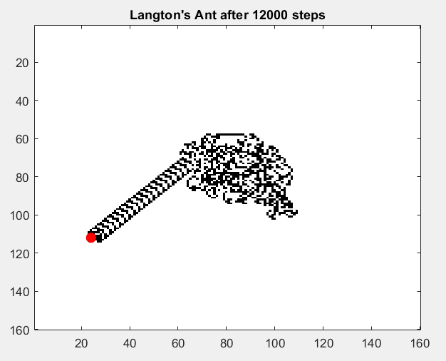
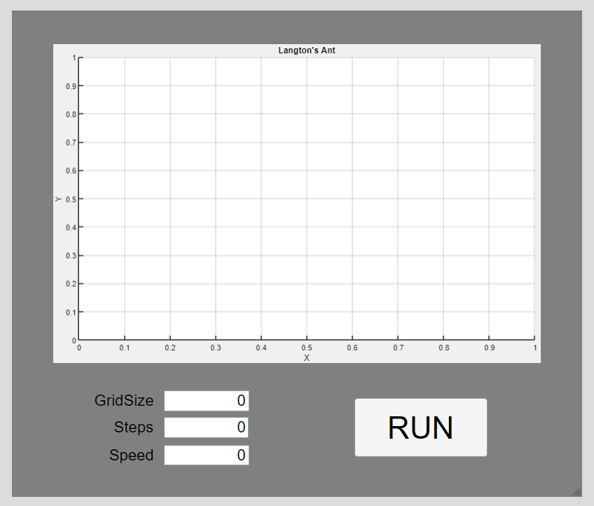
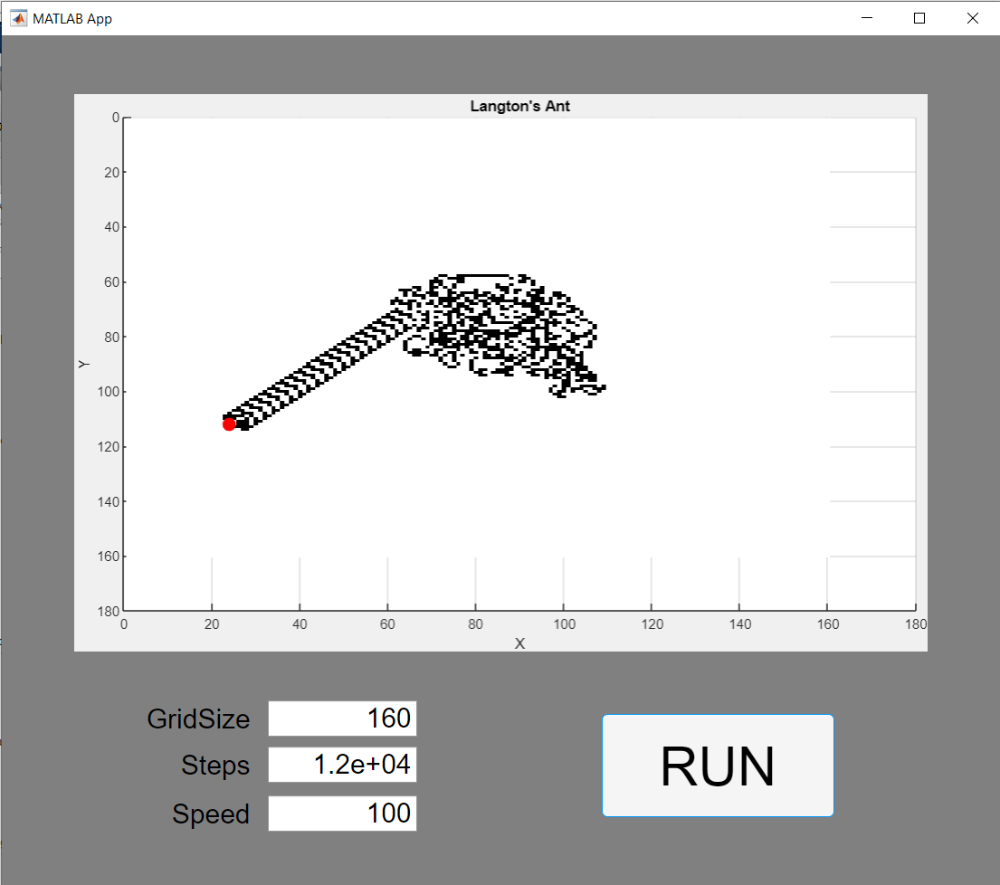

# Langton's Ant Simulation — MATLAB & App Designer

An interactive implementation of **Langton's Ant** developed using MATLAB and MATLAB App Designer. The project includes a command-line MATLAB simulation, a graphical user interface, an App Designer project, and packaged Windows application files.

**Course:** EEE 4416 — Simulation Lab  
**Project Type:** MATLAB Simulation & GUI Project  
**Department:** Electrical and Electronic Engineering  
**Institution:** Islamic University of Technology (IUT)

---

## Overview

Langton's Ant is a cellular automaton in which a virtual ant moves on a grid according to a small set of deterministic rules.

Despite the simplicity of these rules, the ant initially produces complex and apparently chaotic patterns. After a sufficiently large number of steps, a repeating structure known as the **highway** emerges.

This project was developed in three stages:

1. Implementation of the Langton's Ant algorithm in MATLAB
2. Development of an interactive graphical interface using MATLAB App Designer
3. Packaging of the application for standalone use

---

## Langton's Ant Rules

Each cell of the grid can be either **white** or **black**.

At every step:

### On a white cell

1. Turn 90° to the right
2. Change the cell from white to black
3. Move forward by one cell

### On a black cell

1. Turn 90° to the left
2. Change the cell from black to white
3. Move forward by one cell

The implementation starts the ant near the center of the grid and initially points it upward.

The MATLAB implementation also uses **wrap-around boundary conditions**. If the ant crosses one edge of the grid, it re-enters from the opposite side.

---

## MATLAB Simulation

The standalone MATLAB implementation is available at:

[`MATLAB Script File/langtons_ant.m`](MATLAB%20Script%20File/langtons_ant.m)

The function accepts three parameters:

```matlab
langtons_ant(gridsize, num_of_steps, speed)
```

where:

- `gridsize` — size of the square simulation grid
- `num_of_steps` — number of movements performed by the ant
- `speed` — visualization update interval used by the original implementation

### Example

```matlab
langtons_ant(160, 12000, 100);
```

This runs the simulation on a **160 × 160** grid for **12,000 steps**, updating the displayed simulation every 100 steps.

### MATLAB Output

<p align="center">
  
</p>

The result demonstrates the transition from an irregular pattern to the characteristic highway structure associated with Langton's Ant.

---

## MATLAB App Designer GUI

The simulation was also converted into an interactive MATLAB application using **App Designer**.

The GUI allows the user to specify:

- Grid Size
- Number of Steps
- Speed / visualization update interval

and execute the simulation using the **RUN** button.

### Application Interface

<p align="center">
  
</p>

### Application Output

<p align="center">
  
</p>

The simulation result is displayed graphically within the application interface.

---

## App Designer Source

The editable MATLAB App Designer files are available in the [`App`](App/) directory:

```text
App/
├── app1.mlapp
└── app1.prj
```

### Files

- `app1.mlapp` — MATLAB App Designer application source
- `app1.prj` — associated MATLAB project file

The `.mlapp` file can be opened using MATLAB App Designer for viewing or modifying the application interface and callbacks.

---

## Packaged Application

The repository also preserves the installation and deployment files generated during the project.

They are available in:

[`App Installation file`](App%20Installation%20file/)

The main executable files include:

```text
LangtonsAnt.exe
MyAppInstaller_web.exe
```

Additional packaging logs and dependency information generated during application compilation are retained in the same directory for archival purposes.

---

## How to Run

### Option 1 — Run the MATLAB Script

1. Open MATLAB.
2. Navigate to the `MATLAB Script File` directory.
3. Add the directory to the MATLAB path if necessary.
4. Run:

```matlab
langtons_ant(160, 12000, 100);
```

The parameters can be changed to experiment with different grid sizes, numbers of steps, and visualization update intervals.

Detailed original instructions are available at:

[`Instruction for running the langtons ant file.txt`](MATLAB%20Script%20File/Instruction%20for%20running%20the%20langtons%20ant%20file.txt)

---

### Option 2 — Run from MATLAB App Designer

1. Open MATLAB.
2. Open:

```text
App/app1.mlapp
```

3. Run the application from App Designer.
4. Enter:
   - Grid Size
   - Steps
   - Speed
5. Press **RUN**.

---

### Option 3 — Packaged Application

The packaged Windows application files are located in:

```text
App Installation file/
```

These files preserve the application distribution generated during the original project.

---

## Algorithm Structure

The standalone MATLAB implementation follows this general process:

```text
Initialize grid
      │
      ▼
Place ant at center
      │
      ▼
Set initial direction = Up
      │
      ▼
Check current cell color
      │
      ├── White ──► Turn Right ──► Change to Black
      │
      └── Black ──► Turn Left  ──► Change to White
      │
      ▼
Move one cell forward
      │
      ▼
Apply wrap-around boundary condition
      │
      ▼
Update visualization
      │
      ▼
Repeat until requested number of steps is reached
```

---

## Implementation Details

The MATLAB simulation uses:

- Matrix-based grid representation
- Conditional logic for cell-color changes
- Direction-state tracking
- Real-time visualization using `imagesc`
- MATLAB plotting functions
- `drawnow` for animation updates
- Wrap-around grid boundaries
- User-defined simulation parameters

The grid is represented using binary values:

```text
0 = White
1 = Black
```

The ant direction is represented as:

```text
0 = Up
1 = Right
2 = Down
3 = Left
```

---

## Key Observations

The project demonstrated several characteristic behaviors of Langton's Ant:

- Simple deterministic rules can generate highly complex patterns.
- The early movement of the ant appears irregular and chaotic.
- After a large number of iterations, the ant develops a repeating diagonal pattern commonly known as the **highway**.
- MATLAB provides a practical environment for implementing and visualizing cellular-automaton simulations.
- App Designer can convert a numerical simulation into an interactive graphical application.

---

## Repository Structure

```text
Langtons_Ant_Project_simulation-matlab-app_EEE4416/
│
├── README.md
│
├── App Installation file/
│   ├── LangtonsAnt.exe
│   ├── MyAppInstaller_web.exe
│   ├── PackagingLog.html
│   ├── includedSupportPackages.txt
│   ├── mccExcludedFiles.log
│   ├── readme.txt
│   ├── requiredMCRProducts.txt
│   └── unresolvedSymbols.txt
│
├── App/
│   ├── app1.mlapp
│   └── app1.prj
│
├── Docs/
│   └── EEE4416_Group_16_The_Final_Report.pdf
│
├── Figures/
│   ├── app_interface.PNG
│   ├── app_output.PNG
│   └── matlab_output.PNG
│
└── MATLAB Script File/
    ├── langtons_ant.m
    └── Instruction for running the langtons ant file.txt
```

---

## Tools and Technologies

- MATLAB
- MATLAB App Designer
- MATLAB GUI development
- Cellular Automata
- Algorithmic Simulation
- Data Visualization
- Application Packaging

---

## Project Documentation

The original academic project report is available here:

[EEE4416 Group 16 Final Report](Docs/EEE4416_Group_16_The_Final_Report.pdf)

The report contains:

- Project objectives
- Langton's Ant methodology
- MATLAB implementation
- Simulation results
- GUI development
- App output
- Group contribution details

---

## Team Project

This project was completed as a group project for **EEE 4416 — Simulation Lab**.

### Group Members

- Shafayat-Ul-Firoz
- Ahmed Lutfe Inam
- Md. Iftimum Ul Haque
- Ar-Rafi Ishraq
- Miah Rashnan Wahid Purna
- Ashfiq Ul Rahman

---

## My Contributions

My documented contributions to the project included:

- Langton's Ant algorithm development
- MATLAB code debugging
- Contribution to GUI design

The completed project was also maintained and packaged as part of the MATLAB application workflow.

---

## Academic Context

**Course:** EEE 4416 — Simulation Lab  
**Department:** Electrical and Electronic Engineering  
**Institution:** Islamic University of Technology (IUT)  
**Project:** Langton's Ant Software

The objective of the project was to apply MATLAB programming and simulation concepts to develop an interactive software application demonstrating how simple deterministic rules can generate complex behavior.

---

## Author / Repository Maintainer

**Ar-Rafi Ishraq**  
Electrical and Electronic Engineering
